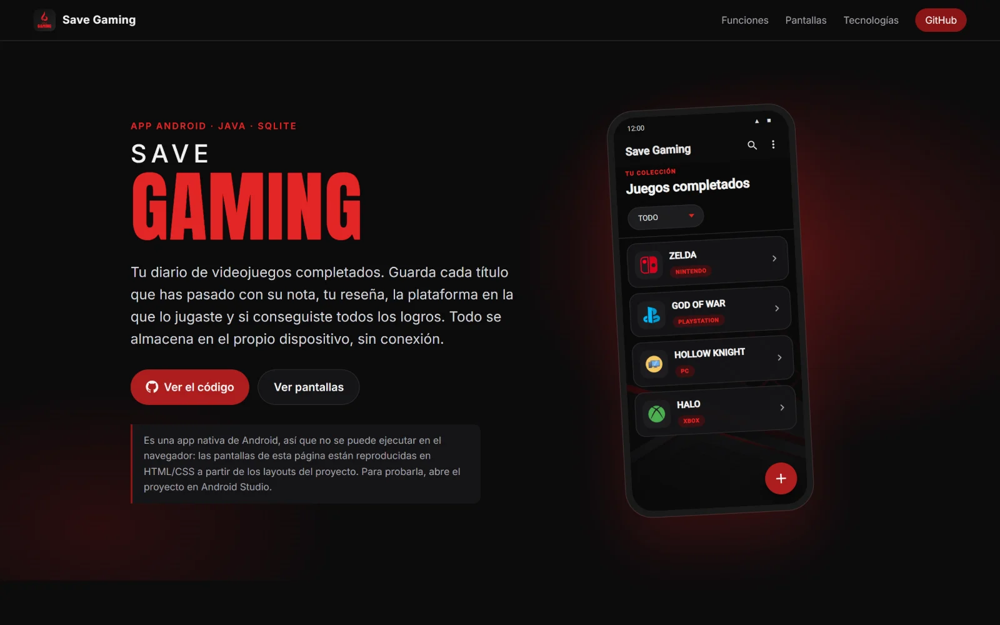
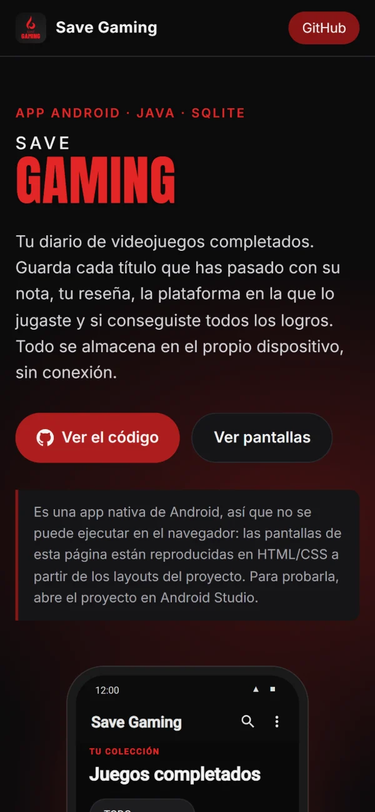
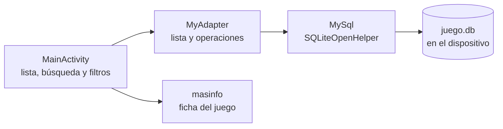

# Save Gaming

Diario de videojuegos para Android: cada vez que terminas un juego, guarda tu nota, tu reseña, la plataforma y si conseguiste todos los logros. Todo se queda en el móvil, sin cuenta ni conexión a Internet.

**[Ver la página del proyecto](https://vanerb.github.io/savegaming-androidstudio/)**: como es una app nativa, no se puede ejecutar en el navegador; la página muestra sus funciones y recrea sus pantallas.

**Stack:** Java · Android SDK (Android 10 o superior) · XML · SQLite

## Qué puedes hacer

- **Registrar juegos:** nombre, reseña, plataforma, nota del 0 al 10 y si tiene el platino (todos los logros).
- **Insignia Must Have:** los juegos con más de un 5 la reciben en su ficha.
- **Buscar y filtrar:** por nombre y por plataforma (PlayStation, PC, Xbox, Nintendo u otra).
- **Editar y borrar:** cambiar cualquier dato de un juego o eliminarlo.

### Capturas

Las pantallas de la app están recreadas en la [página del proyecto](https://vanerb.github.io/savegaming-androidstudio/).

**Página del proyecto**



<p align="center">
  
</p>

## Demo

La [página del proyecto](https://vanerb.github.io/savegaming-androidstudio/) recrea las pantallas principales de la app. Para usarla de verdad hay que instalarla en un móvil o un emulador, como se explica en [Puesta en marcha](#puesta-en-marcha). No tiene cuentas, así que no hace falta contraseña.

## Cómo está construido



```text
app/src/main/java/com/vanerb/savegaming/   Actividades, adaptador de la lista y acceso a SQLite
app/src/main/res/                           Pantallas en XML, iconos y textos
database/                                   Juegos de ejemplo
docs/                                       Página del proyecto en GitHub Pages
```

## Decisiones técnicas

- **Sin servidor ni cuenta.** Los juegos se guardan en una base SQLite del propio dispositivo (`juego.db`), así que la app funciona sin conexión y nadie más ve tus datos.
- **Una sola tabla.** `Game` guarda nombre, reseña, plataforma, platino y nota; la búsqueda y los filtros se resuelven con consultas sobre ella.
- **Interfaz nativa.** Las pantallas están hechas en XML con componentes de Material Design.

## Puesta en marcha

Necesitas Android Studio con el SDK de Android y un móvil o un emulador con Android 10 o superior.

```bash
git clone https://github.com/vanerb/savegaming-androidstudio.git
```

1. En Android Studio, elige **Open** y selecciona la carpeta del proyecto.
2. Espera a que Gradle sincronice las dependencias.
3. Conecta un móvil o inicia un emulador.
4. Pulsa **Run ▶**.

### Datos de prueba

[`database/savegaming_prueba.sql`](database/savegaming_prueba.sql) añade cinco juegos de ejemplo. Con la app abierta en el emulador, ejecuta su contenido desde **App Inspection → Database Inspector** en Android Studio.

## Tests

No tiene tests automáticos.

## Limitaciones conocidas

- Los datos solo existen en el dispositivo: no hay copia de seguridad ni sincronización.
- Las consultas a SQLite se construyen concatenando texto, así que un nombre con apóstrofo (por ejemplo, *Baldur's Gate*) da error al guardarse.

## Autoría

Proyecto de portfolio de **Vanesa Ribera Bautista** ([vanerb](https://github.com/vanerb)).
